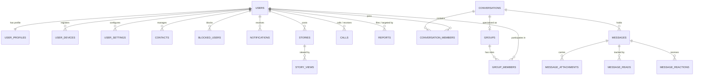

# TAMTAM - Relational Database Architecture & ER Diagram

## Overview
The TAMTAM backend persistence layer uses **MySQL 8.0+** with `InnoDB` engine and `utf8mb4_unicode_ci` collation, fully supporting emojis, multilingual Unicode text, and bidirectional Arabic/RTL strings.

---

## Entity Relationship Diagram (Mermaid)

---

## Detailed Table Dictionary

### 1. `users`
| Column | Type | Constraints | Description |
|---|---|---|---|
| `id` | BIGINT UNSIGNED | PK, AI | Internal integer primary key |
| `uuid` | VARCHAR(36) | UNIQUE, NOT NULL | Public RFC4122 v4 identifier |
| `username` | VARCHAR(40) | UNIQUE, NOT NULL | Alphanumeric handle (e.g. `@samir`) |
| `phone` | VARCHAR(25) | UNIQUE | E.164 international format (e.g. `+213...`) |
| `email` | VARCHAR(191) | UNIQUE | Validated email address |
| `password_hash` | VARCHAR(255) | NOT NULL | Argon2id or bcrypt hashed password |
| `role` | ENUM | user, moderator, admin | Authorization role |
| `status` | ENUM | active, suspended, deactivated | Lifecycle state |
| `last_seen_at` | TIMESTAMP | NULLABLE | Last presence heartbeat |
| `is_online` | BOOLEAN | DEFAULT FALSE | Real-time presence flag |

### 2. `conversations` & `conversation_members`
- Supports both **Direct (1-to-1)** and **Group** conversations under a unified model.
- `conversation_members` maintains per-user state: `unread_count`, `is_pinned`, `is_muted`, `is_archived`, and `last_read_message_id`.

### 3. `messages` & `message_attachments`
- `type`: `text`, `image`, `video`, `audio`, `voice`, `document`, `location`, `system`.
- Supports nested replies (`reply_to_id`) and forwarded messages (`forwarded_from_id`).
- Soft deletion via `deleted_at`.
- Full-text search index (`ft_messages_content`) for instant in-chat query execution.

### 4. `message_reads` & `message_reactions`
- Accurate delivery status tracking (`sent` -> `delivered` -> `read`) with timestamps.
- Emoji reactions with compound uniqueness per `(message_id, user_id, reaction_emoji)`.

### 5. `stories` & `story_views`
- Ephemeral 24-hour expiration (`expires_at`), with privacy controls (`everyone`, `contacts`, `close_friends`).
- `story_views` logs viewers with timestamps for the author's viewers drawer.

### 6. `calls`
- WebRTC voice and video session lifecycle (`initiated`, `ringing`, `accepted`, `ended`, `missed`, `busy`).
- Call duration tracking and call history.
